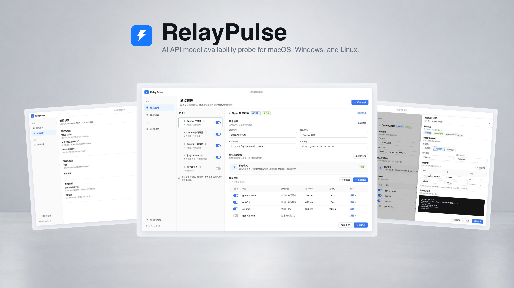

  

<h1 align="center">RelayPulse</h1>

  常驻系统托盘的 AI API 模型可用性探针。

  
  
  
  
  

  <a href="#功能">功能</a> ·
  <a href="https://skyzfdance.github.io/RelayPulse/">文档中心</a> ·
  <a href="https://github.com/skyzfdance/RelayPulse/releases">下载与更新</a> ·
  <a href="https://github.com/skyzfdance/RelayPulse/issues">问题反馈</a>

RelayPulse 向配置的模型服务发送最小化生成请求，检查实际响应，并记录模型状态、首 Token 耗时、总耗时及供应商上报的 Token 用量。打开托盘小面板即可查看结果，主窗口用于管理站点、探针策略和历史记录。

RelayPulse 当前仅支持 macOS 桌面端。Windows 和 Linux 平台尚未完成兼容性适配与实机验证，欢迎通过 Pull Request 参与平台适配、测试及改进。

> [!WARNING]
> 本项目主要通过 Vibe Coding 开发，仍在持续迭代。请在使用前审查代码，并在自己的使用环境中验证。

> [!IMPORTANT]
> 探测会向配置的模型服务发送真实 API 请求，并可能产生费用。用量取决于启用模型数量、探测频率、请求参数和服务商计费规则。

  

## 功能

| 功能 | 当前能力 |
| --- | --- |
| 站点与模型 | 多站点管理、拖动排序、启停、远端模型同步与手动添加 |
| 协议适配 | OpenAI Compatible、OpenAI Responses、Anthropic、自定义 HTTP |
| 探针策略 | 站点默认策略、模型独立覆盖、请求参数配置与草稿试探 |
| 正式探测 | 手动与周期探测、慢响应识别、连续失败与恢复判定 |
| 托盘小面板 | 原生小面板，集中查看模型状态、首 Token 与总耗时 |
| 记录与用量 | 探测记录、请求与响应详情、Token 统计、操作记录 |
| 模型测试 | 题库管理、多模型与推理强度对比、测试历史及输出回放 |
| 消息通知 | 模型故障、恢复与测试完成通知，以及通知模板配置 |
| 外观与诊断 | 明暗及跟随系统主题、后台运行、诊断日志与导出 |

安装与操作说明见[使用者手册](https://skyzfdance.github.io/RelayPulse/user/)，开发环境、命令、项目结构与构建说明见[开发者文档](https://skyzfdance.github.io/RelayPulse/developer/)。

## License

[MIT](./LICENSE)
