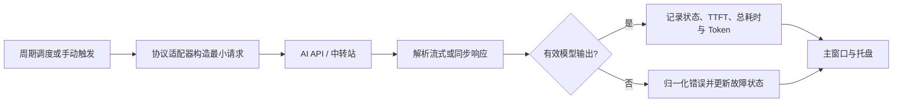

<p align="center">
  
</p>

<h1 align="center">RelayPulse</h1>

<p align="center">
  驻留系统托盘，用最小化真实生成请求持续验证 AI 模型是否真的可用。
</p>

<p align="center">
  
  
  
  
  <a href="./LICENSE"></a>
</p>

<p align="center">
  <a href="#项目定位">项目定位</a> ·
  <a href="#核心能力">核心能力</a> ·
  <a href="#快速开始">快速开始</a> ·
  <a href="#常用命令">常用命令</a> ·
  <a href="#数据与安全">数据与安全</a> ·
  <a href="#开发与验证">开发与验证</a>
</p>

> [!WARNING]
> 本项目主要通过 Vibe Coding 方式完成，不对代码质量或生产可用性作出保证。请在使用前自行审查代码，并在符合自身安全要求的环境中充分验证。

> [!IMPORTANT]
> 启动探针会向你配置的模型服务发送真实 API 请求，并可能产生实际费用。具体费用取决于服务商的计费规则、探测频率、启用模型数量及 Token 用量；启用前请确认账户额度与价格，并优先使用权限受限、可随时撤销的凭据。

<p align="center">
  
</p>

## 项目定位

RelayPulse 是面向 macOS、Windows 与 Linux 桌面的 AI API 模型可用性探针。它常驻系统托盘，按照设定频率向已启用模型发送低成本的真实生成请求，并把整体健康状态、首 Token 耗时与总耗时呈现在轻量状态面板中。

它不是普通的站点 Ping 工具。只有协议解析器收到有效模型输出并通过校验，一次探测才会被判定为成功。这可以区分“接口能够连接”和“模型能够实际完成生成”。

## 核心能力

| 能力         | 说明                                                               |
| ------------ | ------------------------------------------------------------------ |
| 真实模型探测 | 发送最小化生成请求并校验实际输出，不用网络连通性冒充模型可用性     |
| 托盘优先     | 用红、黄、绿状态快速表达整体健康度，主窗口专注配置与记录           |
| 可信耗时     | 流式请求分别记录响应头时间、首 Token 时间（TTFT）与总耗时          |
| 多站点管理   | 支持站点排序、启停、模型同步、手动模型及站点级探针策略             |
| 多协议适配   | 支持 OpenAI Compatible、OpenAI Responses、Anthropic 与 Custom HTTP |
| 本地状态     | 使用 SQLite 保存配置、模型、探测记录和最新状态投影                 |
| 低成本策略   | 支持限制输出、关闭或降低推理强度、周期错峰与同模型防重入           |
| 诊断与追踪   | 提供结构化、脱敏的操作链路、错误编号、日志与诊断包                 |

## 探测流程



- 流式心跳、空增量、角色字段和元数据不会被误判为首 Token。
- 非流式响应不会用完整响应时间冒充 TTFT。
- 同一个模型不会同时运行多个重叠探测任务。
- 停用站点或没有启用模型的站点不会参与状态聚合。

## 快速开始

### 环境要求

- Node.js 当前 LTS
- pnpm `9.10.0`
- Rust stable
- 目标平台所需的 Tauri 2 系统依赖

### 启动桌面应用

```bash
git clone https://github.com/skyzfdance/RelayPulse.git
cd RelayPulse
pnpm install
pnpm t:dev
```

`pnpm t:dev` 会启动完整的 Tauri 桌面应用。只需要在浏览器中查看前端和 mock 场景时，可以运行：

```bash
pnpm dev
```

浏览器预览支持通过查询参数切换界面，例如 `?view=sites`、`?view=records`、`?view=tray-healthy`，也可以使用 `theme=light` 或 `theme=dark` 固定主题。

## 常用命令

| 命令               | 用途                                       |
| ------------------ | ------------------------------------------ |
| `pnpm t:dev`       | 启动 Tauri 桌面开发环境                    |
| `pnpm dev`         | 启动 Vite 前端预览                         |
| `pnpm build`       | 执行 TypeScript 检查并构建前端             |
| `pnpm test`        | 运行前端单元与组件测试                     |
| `pnpm test:rust`   | 运行 Rust 测试                             |
| `pnpm test:e2e`    | 运行端到端测试                             |
| `pnpm test:visual` | 运行固定视口视觉回归测试                   |
| `pnpm check`       | 运行格式、Lint、类型、前后端测试与视觉检查 |

## 构建与分发

```bash
pnpm t:build
```

构建产物由 Tauri 写入 `src-tauri/target/release/bundle/` 下对应的平台目录。

macOS 构建明确启用了 `macos-private-api` 和 `macOSPrivateApi`，以支持项目所需的窗口与托盘行为。因此当前产物不以 Mac App Store 审核和上架为目标。正式分发前还需要按目标平台完成签名、公证、安装和托盘行为验证。

## 数据与安全

- API Key 不写入 SQLite、前端状态、日志、诊断包或探测记录。
- 当前开发版本将凭据写入应用数据目录中的 `credentials.json`，Unix 平台会尝试设置为 `0600` 权限。
- 该本地凭据文件目前**没有应用层加密**，安全性依赖操作系统用户目录和文件权限。
- URL、Header、错误、请求摘要与响应摘要在持久化或写入日志前需要经过统一脱敏和大小限制。
- 不保存完整模型回答，也不会把用户业务数据作为探针内容发送。

在凭据安全模型和目标平台验收完成之前，建议仅使用可撤销、权限受限且额度可控的测试凭据。

## 开发与验证

RelayPulse 使用分层测试覆盖前端交互、Rust 后端、桌面工作流和视觉基线：

- **前端测试：** 使用 Vitest 与 Testing Library 验证组件、状态和数据源行为。
- **Rust 测试：** 覆盖持久化、协议解析、探测执行、调度、诊断和凭据生命周期。
- **端到端测试：** 使用 Playwright 验证站点配置、探测记录、托盘面板等主要流程。
- **视觉回归：** 对关键页面和明暗主题执行固定视口截图对比。
- **完整检查：** 运行 `pnpm check`，统一执行格式、Lint、类型检查及前后端测试。

### 技术栈

- **桌面壳：** Tauri 2、Rust、Tokio
- **前端：** React 19、TypeScript、Vite、Ant Design 6、Tailwind CSS 4
- **本地数据：** SQLite、`rusqlite`、版本化 migration
- **网络与协议：** `reqwest`、SSE / JSON 流解析、协议适配器
- **测试：** Vitest、Testing Library、Playwright、Rust 单元与集成测试

## License

RelayPulse 使用 [MIT License](./LICENSE) 发布。
