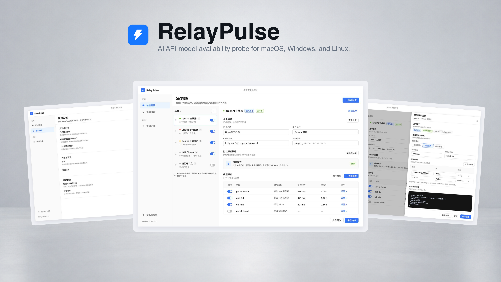

<p align="center">
  
</p>

<h1 align="center">RelayPulse</h1>

<p align="center">
  常驻系统托盘的 AI API 模型可用性探针。
</p>

<p align="center">
  
  
  
  
  <a href="./LICENSE"></a>
</p>

<p align="center">
  <a href="#功能">功能</a> ·
  <a href="#快速开始">快速开始</a> ·
  <a href="#开发与验证">开发与验证</a> ·
  <a href="#构建与环境隔离">构建与环境隔离</a> ·
  <a href="#数据与凭据">数据与凭据</a>
</p>

RelayPulse 向配置的模型服务发送最小化生成请求，检查实际响应，并记录模型状态、首 Token 耗时、总耗时及供应商上报的 Token 用量。打开托盘小面板即可查看结果，主窗口用于管理站点、探针策略和历史记录。

RelayPulse 当前仅支持 macOS 桌面端。Windows 和 Linux 平台尚未完成兼容性适配与实机验证，欢迎通过 Pull Request 参与平台适配、测试及改进。浏览器入口仅用于前端开发与 mock 预览。

> [!WARNING]
> 本项目主要通过 Vibe Coding 开发，仍在持续迭代。请在使用前审查代码，并在自己的使用环境中验证。

> [!IMPORTANT]
> 探测会向配置的模型服务发送真实 API 请求，并可能产生费用。用量取决于启用模型数量、探测频率、请求参数和服务商计费规则。

<p align="center">
  
</p>

## 功能

| 功能       | 当前能力                                                               |
| ---------- | ---------------------------------------------------------------------- |
| 站点与模型 | 多站点管理、拖动排序、启停、远端模型同步与手动添加模型                 |
| 协议适配   | OpenAI Compatible、OpenAI Responses、Anthropic、自定义 HTTP            |
| 探针策略   | 站点默认策略、模型独立覆盖、请求参数配置与草稿试探                     |
| 正式探测   | 手动探测、周期调度、慢响应阈值、连续失败与恢复阈值                     |
| 托盘小面板 | 独立窗口，按站点分组展示状态及「首 Token / 总耗时」，最多显示 3 个模型 |
| 探测记录   | 筛选分页、详情、请求与响应过程、Token 统计及历史清理                   |
| 外观与诊断 | 明暗及跟随系统主题、后台探测设置、诊断日志与导出                       |

小面板区分等待探测和已有结果，逐行展示正常、偏慢、不可用或待确认状态；缺失耗时显示 `—`。单击或双击托盘图标只切换小面板，点击外部关闭，点击面板设置才打开主窗口。macOS 使用原生毛玻璃材质，并同步应用主题。

托盘图标的蓝色表示已存在可参与面板展示的启用站点和模型；模型健康状态在面板内展示。

支持通知设置、模板配置，以及 macOS 通知权限管理和测试通知。

### 探测口径

- 常规模型请求需要成功的 HTTP 响应、有效回答正文及对应协议的完成标记；只有思考内容或连接成功不能判定探测成功。自定义 HTTP 按 2xx 响应和响应体完整读取判断。
- 流式首 Token 从请求开始计时，到第一段非空思考文本或回答正文到达为止。空增量、角色、心跳和工具参数不触发计时；非流式和自定义请求不填首 Token 耗时。
- 健康状态按慢响应、连续失败和恢复阈值推进；已有探测结果但尚未达到首次健康判定阈值时，面板显示「待确认」及实际耗时。
- 自动探测要求后台探测、站点和模型均已启用；手动探测由用户显式触发。同一站点的任务统一互斥，避免同步、试探和正式探测重叠执行。

## 快速开始

需要 Node.js 22.12+、pnpm `9.10.0`、Rust stable，以及目标平台所需的 Tauri 2 编译依赖。

```bash
git clone https://github.com/skyzfdance/RelayPulse.git
cd RelayPulse
pnpm install --frozen-lockfile
pnpm dev:desktop
```

该命令启动独立的 **RelayPulse Dev**，运行 Vue 前端和真实 Rust 后端。首次启动需要下载并编译 Rust 依赖。

仅开发前端时运行：

```bash
pnpm dev:web
```

打开 <http://localhost:1421> 查看主窗口，或 <http://localhost:1421/panel> 查看小面板。浏览器中的 API 调用由 mock 处理；小面板默认等待探测，点击刷新可演示已有结果。原生托盘、窗口定位和系统材质需在桌面应用中验证。

## 开发与验证

```text
frontend/       Vue 源码、测试、依赖和前端工具配置
backend/        Rust 源码、测试、Cargo / Tauri 配置及平台资源
scripts/        桌面启动、环境隔离和打包脚本及其测试
docs/assets/    README 使用的图片等公开资源
```

前端使用 Vue 3、TypeScript、Pinia、antdv-next 和 Tailwind CSS 4；后端使用 Tauri 2、Rust、Tokio、reqwest 和 SQLite。前端经统一 API 层调用 Tauri 命令，后端通过 Tauri 事件通知小面板重读状态。

以下命令均在仓库根目录执行：

| 命令                        | 用途                                               |
| --------------------------- | -------------------------------------------------- |
| `pnpm typecheck`            | 前端源码、测试和工具配置的类型检查                 |
| `pnpm lint`                 | 前端 ESLint、脚本 ESLint 和 Rust Clippy            |
| `pnpm format:check`         | 前端 Prettier 和 Rust 格式检查                     |
| `pnpm test:frontend`        | Vue 单元与组件测试                                 |
| `pnpm test:backend`         | Rust 单元与集成测试                                |
| `pnpm test:desktop-scripts` | 桌面环境隔离及 macOS 开发 runner 测试              |
| `pnpm test:e2e`             | 浏览器端到端测试，当前覆盖导航和主题               |
| `pnpm check:all`            | 顺序执行格式、Lint、类型和测试检查，不执行生产构建 |
| `pnpm info:desktop`         | 查看 Tauri 与系统环境信息                          |

首次运行浏览器端到端测试前，可执行 `pnpm --dir frontend exec playwright install chromium` 安装测试浏览器。原生托盘、焦点、窗口定位和材质效果通过桌面实机验证。

Prettier 只检查 `frontend/`，Rust 使用 rustfmt。`pnpm format` 和 `pnpm lint:fix` 可执行相应的自动修复。

## 构建与环境隔离

```bash
pnpm build:desktop:dev         # 开发测试安装包
pnpm build:desktop:production  # 正式安装包
```

| 项目           | 开发与开发测试包                                        | 正式包                                              |
| -------------- | ------------------------------------------------------- | --------------------------------------------------- |
| 应用名称       | RelayPulse Dev                                          | RelayPulse                                          |
| 应用标识       | `com.relaypulse.app.dev`                                | `com.relaypulse.app`                                |
| macOS 数据目录 | `~/Library/Application Support/com.relaypulse.app.dev/` | `~/Library/Application Support/com.relaypulse.app/` |
| 前端资源       | `frontend/dist/development/`                            | `frontend/dist/production/`                         |
| Cargo 输出     | `backend/target/development.noindex/`                   | `backend/target/production/`                        |

开发与正式环境分别保存数据库、记录文件和诊断数据，单实例锁与自启动项也按应用身份隔离。开发启动不会复制正式数据，开发包不应覆盖正式应用或共用其数据目录。

桌面命令通过 `scripts/` 包装器选择环境；`build:assets:*` 由打包流程调用。`pnpm build:web` 仅生成前端开发资源，供浏览器检查或桌面打包使用。

macOS 当前启用私有窗口 API，以支持原生小面板；当前分发不面向 Mac App Store。正式发布仍需完成各平台的签名、打包与安装验证。

## 数据与凭据

- 站点、模型、设置、正式探测记录和当前健康状态保存在应用数据目录的 `relaypulse.sqlite3`。
- 站点访问凭据保存在 SQLite 的 `site_credentials` 表，目前没有应用层加密，也未接入系统钥匙串。站点读取接口只返回是否配置凭据，不回传密钥。
- Unix 平台将应用数据根目录权限设为 `0700`、数据库设为 `0600`；本地数据保护仍依赖操作系统账户与文件权限。
- 正式探测会在 `probe-records/` 保存经脱敏的请求和响应过程文件，可能包含模型输出。文件随历史保留策略或手动清理处理；草稿试探不写入正式历史。
- 诊断日志和导出采用独立的脱敏与保留规则，正式探测响应文件不混入诊断包。
- Token 统计保留供应商实际上报的数据，缺失项留空，不根据模型输出估算。

## License

[MIT](./LICENSE)
